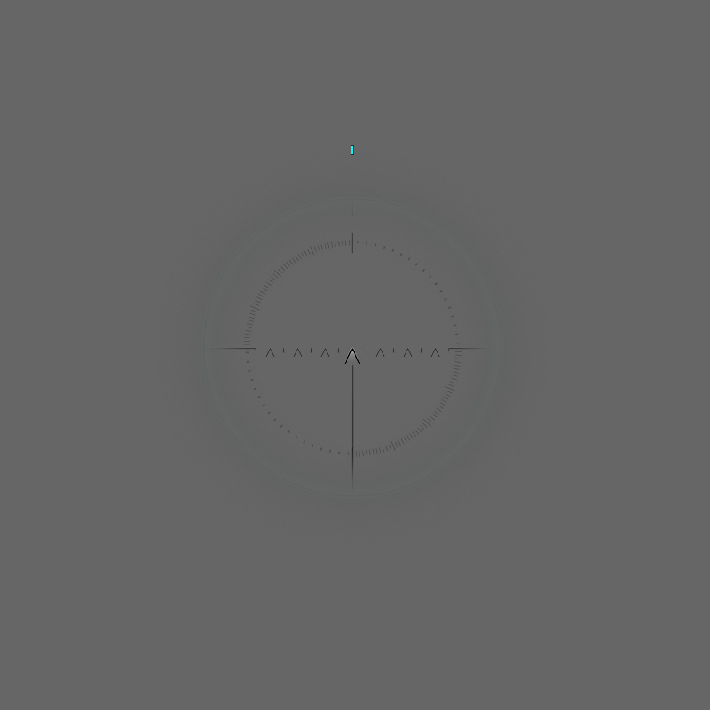
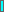
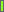
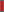

# Reworked Reticle

	&bull; <a href="#en">EN</a> &bull; <a href="#ru">RU</a> 

## EN

9 colors for the lines, 2 variants: one for the advanced damage indicator and one for the standard damage indicator

You can customize the reticle in the settings, as it was done on the vanilla client

  

### Arcade, Sniper, Strategic & Assault | Postmortem without "Line"

<table align="center">
  <tr>
    <td colspan="15" align="center"><strong>Line</strong></td>
  </tr>
  <tr>
    <td align="center"></td>
    <td align="center"></td>
    <td align="center"></td>
    <td align="center"></td>
	<td align="center"></td>
	<td align="center"></td>
	<td align="center"></td>
	<td align="center"></td>
	<td align="center"></td>
  </tr>
  <tr>
    <td align="center">Aqua</td>
    <td align="center">Black</td>
    <td align="center">GreenV1</td>
    <td align="center">GreenV2</td>
	<td align="center">Orange</td>
	<td align="center">Purple</td>
	<td align="center">Red</td>
	<td align="center">White</td>
	<td align="center">Yellow</td>
  </tr>
</table>

## RU

9 цветов для линии, 2 варианта: один для расширенного индикатора урона и один для стандартного индикатора урона

Настроить прицел можно в настройках, как это делалось на ванильном клиенте

  

### Аркадный, Снайперский, Стратегический и Штурмовой | Посмертный без "Линия"

<table align="center">
  <tr>
    <td colspan="15" align="center"><strong>Линия</strong></td>
  </tr>
  <tr>
    <td align="center"></td>
    <td align="center"></td>
    <td align="center"></td>
    <td align="center"></td>
	<td align="center"></td>
	<td align="center"></td>
	<td align="center"></td>
	<td align="center"></td>
	<td align="center"></td>
  </tr>
  <tr>
    <td align="center">Aqua</td>
    <td align="center">Black</td>
    <td align="center">GreenV1</td>
    <td align="center">GreenV2</td>
	<td align="center">Orange</td>
	<td align="center">Purple</td>
	<td align="center">Red</td>
	<td align="center">White</td>
	<td align="center">Yellow</td>
  </tr>
</table>